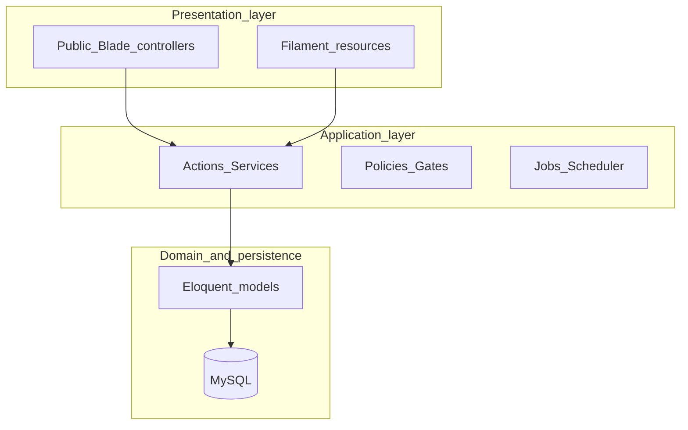

# PROOFTAG-CATIS — Modern technical implementation plan (master)

**Companion docs:** Legacy audit and stack context stay in [prooftag-catis_website_redesign_85860bfc.plan.md](d:/websiteprooftag/.cursor/plans/prooftag-catis_website_redesign_85860bfc.plan.md). **This document** is the step-by-step build order. **One phase completes its gate before the next starts.** No mixing database migrations with public Blade work or Filament modules before backend services exist.

---

## A. Baseline and layer model

| Item | Choice |
|------|--------|
| Backend framework | Laravel 13, PHP 8.4 |
| Database | MySQL 8.x |
| Public UI | Blade, Tailwind CSS 4, Vite, Alpine.js (selective), Lucide |
| Admin | Filament 5 (Livewire 4)—**admin only**, not public SPA |
| Hosting | LWS Starter (docroot `public/`, cron `schedule:run`, sync queues) |
| Locales | FR default (`/`), EN (`/en/...`) |
| Repo root | [d:/websiteprooftag](d:/websiteprooftag) |



**Rule:** Controllers and Filament resources stay thin. **Business rules live in Actions/Services** (Phase 11). Filament never owns publication, translation, or redirect logic inline.

---

## B. Chronological phases — overview map

| # | Phase name | Layer touched | Code allowed? |
|---|------------|---------------|---------------|
| 1–3 | Documentation, preservation, content audit | Docs only | No |
| 4–5 | Requirements, information architecture | Docs only | No |
| 6–7 | Technical architecture, local setup | Config/tooling | Scaffold only after Gate 7 |
| 8 | Application shell | Foundation | Yes—minimal |
| **9** | **Database design** | **Database** | **Design docs + ADRs only** |
| **10** | **Database build** | **Database** | **Migrations/seeds only** |
| **11** | **Backend design** | **Backend** | **Specs + interfaces; no Filament yet** |
| **11B** | **Backend implementation** | **Backend** | **Actions, policies, jobs, middleware** |
| **12** | **Admin platform** | **Admin** | **Filament resources** |
| 13 | CMS validation | Admin + data | Sample content only |
| 14 | UI/UX design | Design | Figma/tokens—not production pages |
| **15** | **Frontend foundation** | **Frontend** | **Layouts, components, CSS** |
| **16** | **Public frontend** | **Frontend** | **Page templates + wiring** |
| 17–18 | Migration, bilingual | Content | Scripts/seeders |
| 19 | SEO and redirects | Backend + frontend | Meta, sitemap, middleware |
| 20 | Security hardening | Cross-cutting | Config, headers, MFA |
| 21 | Performance | Cross-cutting | Media, cache, queries |
| **22** | **Testing and acceptance** | **QA** | **Pest suites, checklists** |
| **23–27** | **Deployment** | **Ops** | **LWS staging → production** |
| 28–30 | Handover, maintenance, infra review | Ops | Docs |

---

# BLOCK 1 — PROJECT DOCUMENTATION (Phases 1–3)

## Phase 1 — Project initiation

**Objective:** Frozen scope before code.

**Steps:**

1.1 Write `docs/charter/project-charter.md` (goal, in-scope, exclusions: operational CERTIDOCS/CT-VERIF/DOSER/Video platforms are **linked**, not embedded).

1.2 Record product catalogue (5 solutions; **DITROS-CT excluded**).

1.3 Master contact record: PROOFTAG-CATIS S.A., Immeuble Résidence Le Carat, Hôtel de l’Air, Bonapriso, BP 4601 Douala, +237 699 19 29 19, info@prooftagcatis.com.

1.4 Brand constraints: Royal Blue + White; no stray accent colours.

1.5 Navigation: logo = home; no Accueil menu item; eight top-level sections (À propos, Produits, Expertises, Contrôle technique, Centres, Ressources, Actualités, Contact).

1.6 Canonical URL policy: `https://www.prooftagcatis.com`; redirect `site.`, `net.`, apex as decided.

**Deliverables:** Charter, scope, exclusions, nav baseline, tech baseline.

**Gate:** Product owner sign-off → Phase 2.

---

## Phase 2 — Legacy preservation

**Steps:** 2.1 Inventory URLs (www, site, net, external apps). 2.2 Capture page content/metadata per URL. 2.3 Archive media (prefer originals). 2.4 `docs/legacy/legacy-url-register.csv`. 2.5 Full backup (files, DB if any, DNS/mail notes).

**Gate:** Archives complete → Phase 3.

---

## Phase 3 — Content audit

**Steps:** 3.1 `docs/content/content-audit.csv` (ID, source, category, six statuses: Current / Rewrite / Verification / Historical / Archive / Reject). 3.2 Reconcile duplicates www vs site. 3.3 Verification list (team, centres, regulations, product copy gaps). 3.4 Product factual baselines (5 products). 3.5 Separate 2020 reform content (current vs historical).

**Gate:** Audit approved → Phase 4.

---

# BLOCK 2 — REQUIREMENTS AND IA (Phases 4–5)

## Phase 4 — Functional requirements

**Steps:** 4.1 Audience model. 4.2 Public capabilities (browse, search centres, download resources, contact, language switch, external product links). 4.3 Admin capabilities (full CMS list from charter). 4.4 Editorial workflow: Draft → Under Review → Approved → Scheduled → Published → Archived. 4.5 Contact workflow: New → In Progress → Responded → Closed → Spam. 4.6 NFRs: WCAG 2.2 AA, SEO, security, maintainability.

**Deliverable:** `docs/requirements/functional-spec.md`.

**Gate:** Spec stable → Phase 5.

---

## Phase 5 — Information architecture

**Steps:** 5.1 Approve sitemap. 5.2 Content-type map (pages, products, expertise, CT articles, centres, resources, posts, careers). 5.3 Relationship map (product ↔ expertise ↔ articles). 5.4 URL/slug rules FR and EN.

**Deliverable:** `docs/ia/sitemap-and-content-types.md`.

**Gate:** IA signed → **database design may begin**.

---

# BLOCK 3 — ARCHITECTURE AND SETUP (Phases 6–8)

## Phase 6 — Technical architecture

**Steps:** 6.1 Confirm stack table (Section A). 6.2 Environments: local, staging (noindex), production. 6.3 LWS constraints (no Redis workers, 45 GB bandwidth, cron PHP invocation, Cloudflare cron note). 6.4 Runtime: file/database cache & sessions, sync queue, SMTP. 6.5 Storage disks: `public`, `documents`, `private`. 6.6 Package list: spatie/permission + Filament Shield, activitylog, medialibrary, sitemap, honeypot; Leaflet for centres. 6.7 ADR-001 translation strategy (custom translation tables recommended for slug + SEO per locale).

**Deliverable:** `docs/architecture/system-architecture.md`.

**Gate:** Architecture agreed → Phase 7.

---

## Phase 7 — Local development setup

**Steps:** 7.1 Install PHP 8.4, Composer, MySQL, Node LTS, Git. 7.2 Create DB `prooftag_catis_local`. 7.3 Init Git (`main`, `develop`, `feature/*`). 7.4 `.env.example` documented; secrets never committed. 7.5 Mail: Mailpit/Mailhog locally. 7.6 `docs/development/standards.md` (Pint, Pest, naming, commits).

**Gate:** `composer install` + `npm install` reproducible → Phase 8.

---

## Phase 8 — Application foundation (shell only)

**Objective:** Empty Laravel 13 app ready for domain work—not features.

**Steps:** 8.1 `composer create-project laravel/laravel` in repo root. 8.2 App name, timezone (`Africa/Douala`), locale `fr`, fallback `en`. 8.3 Install Filament 5 panel at `/admin`—login only. 8.4 Install Shield; seed roles (Super Admin, Admin, Content Manager, Technical Editor, Communications Editor, Translator, Reviewer/Publisher, Support Agent). 8.5 Activity log on User model. 8.6 Locale middleware + route groups (`web`, `en` prefix). 8.7 **Do not** create business migrations yet.

**Gate:** Admin login + roles work → Phase 9.

---

# BLOCK 4 — DATABASE LAYER (Phases 9–10)

## Phase 9 — Database design (no migrations)

**Objective:** Approved logical model before any `php artisan make:migration` for domain tables.

**Steps:**

9.1 **Entity inventory** — settings, pages+translations, products+translations, expertise+translations, security_points+translations, equipment, inspection_centres+translations, regions, partners, team_members, resources+translations, posts+translations, categories, tags, careers, contact_requests, redirects, seo_meta (polymorphic or per translation), media (Spatie).

9.2 **Language split** — columns vs tables: status, dates, FKs, coordinates language-independent; title, slug, body, SEO language-dependent.

9.3 **Translation pattern** — e.g. `products` + `product_translations` (`locale`, `slug` unique per locale, `title`, `summary`, `body`, `meta_title`, `meta_description`).

9.4 **Publication** — shared enum `publication_status` + `published_at`, `scheduled_for`, `reviewed_at`, `reviewed_by`.

9.5 **Centres** — `verification_status` enum; `last_verified_at`; region FK; nullable lat/lng.

9.6 **Resources** — `regulatory_status`: current | historical | archive.

9.7 **Redirects** — `from_path`, `to_path`, `http_status`, `source_host` optional.

9.8 **Retention** — soft deletes vs status archived; no hard delete for audit trail on editorial.

9.9 **Indexes** — slugs, `(locale, publication_status, published_at)`, centre `(region_id, verification_status)`.

9.10 **ERD** — `docs/database/erd.pdf` or Mermaid in `docs/database/erd.md`.

**Deliverables:** Logical schema, ERD, ADR-001, indexing notes.

**Gate:** ERD signed → Phase 10.

---

## Phase 10 — Database implementation

**Objective:** Migrations and reference data only—no Filament resources yet.

**Steps:**

10.1 Migrations order: locales/regions → users/roles (Shield) → settings → translations pattern tables → pivots → contact_requests → redirects.

10.2 Foreign keys, cascades on delete (restrict for published content).

10.3 Seeders: Cameroon regions, publication statuses, roles/permissions, **no unverified company copy as fact**.

10.4 Factory stubs for tests (Product, Post, Centre).

10.5 Run migrations on clean DB; document rollback.

**Gate:** `php artisan migrate:fresh --seed` passes; schema review → **Phase 11 (backend design)**.

---

# BLOCK 5 — BACKEND LAYER (Phases 11 and 11B)

## Phase 11 — Backend design (specification only)

**Objective:** Define how the application behaves between HTTP/Filament and the database. **No Filament CRUD modules until 11B is done.**

### 11.1 Layered request flow

```
HTTP Request
  → Middleware (locale, redirects, security headers)
  → Form Request (validation)
  → Controller / Filament (authorize)
  → Action or Service (business logic)
  → Model(s) + DB
  → Response / View / Filament notification
```

### 11.2 Domain modules and responsibilities

| Module | Namespace (example) | Owns |
|--------|---------------------|------|
| Corporate | `App\Domain\Corporate` | Settings, pages, team, partners |
| Products | `App\Domain\Products` | Solutions catalogue, capabilities, external URLs |
| Expertise | `App\Domain\Expertise` | Expertise records and relations |
| TechnicalInspection | `App\Domain\TechnicalInspection` | CT content, 12 points, equipment |
| Centres | `App\Domain\Centres` | Directory, verification, geocoding hook |
| Editorial | `App\Domain\Editorial` | Posts, categories, workflow |
| Resources | `App\Domain\Resources` | Documents, regulatory status |
| Communication | `App\Domain\Communication` | Contact form, notifications |
| Seo | `App\Domain\Seo` | Meta, sitemap data, hreflang helpers |
| Media | `App\Domain\Media` | Upload rules, conversions, usage guards |

### 11.3 Core services (design each with public methods + invariants)

- **`PublicationService`** — who can transition states; draft never public; scheduled visible only after `scheduled_for`; unpublish rules.

- **`TranslationService`** — missing EN handling; slug generation; hreflang pairs; “fallback to FR” policy for UI labels only, not marketing body without review.

- **`ProductCatalogService`** — ordered list; filter by status; resolve by slug per locale.

- **`CentreDirectoryService`** — filter by region/status; search; paginate; import marks Unverified.

- **`ResourceLibraryService`** — filter by type and regulatory_status; secure download path.

- **`ContactSubmissionService`** — honeypot, rate limit, persist, notify, spam flag.

- **`RedirectResolver`** — legacy host + path → 301/302; log misses for Phase 27.

- **`SeoMetaResolver`** — merge global defaults + per-record translation meta; canonical URL builder.

- **`MediaAttachmentService`** — allowed MIME/size; Spatie collections; block delete if in use.

### 11.4 Authorization model

- Policies per model: `ProductPolicy`, `PostPolicy`, `InspectionCentrePolicy`, etc.

- Map Filament Shield permissions to policies (`viewAny`, `update`, `publish`, `translate`).

- **`publish` permission** separate from `update`.

### 11.5 Validation rules (Form Requests + domain)

- Unique slugs per locale; scheduled posts require future `scheduled_for`; centre requires region + name; uploads max size aligned LWS `upload_max_filesize`.

### 11.6 Events and listeners (design)

- `ContentPublished`, `ContentScheduled`, `ContactReceived`, `CentreVerified` → activity log + optional mail to Communications.

### 11.7 Scheduled tasks

- `PublishScheduledContent` (every minute or hourly—keep lightweight for LWS cron).

- `PruneOldLogs` weekly.

### 11.8 Public read API (internal only)

- **No public REST API V1.** Read paths: Eloquent via Actions called from controllers. Optional: ViewModels (`App\ViewModels\...`) assemble DTOs for Blade.

### 11.9 Error handling

- Public: generic 404/500 branded pages; log details server-side only.

- Admin: Filament notifications + validation messages.

**Deliverables:** `docs/backend/domain-design.md`, `docs/backend/services-catalog.md`, policy matrix CSV.

**Gate:** Backend design reviewed → Phase 11B.

---

## Phase 11B — Backend implementation

**Objective:** Implement services, policies, middleware, jobs—**still no public Blade pages and no full Filament modules.**

**Steps:**

11B.1 Implement Actions/Services listed in 11.3.

11B.2 Register policies; wire Shield permissions.

11B.3 Middleware: `SetLocale`, `LegacyRedirect`, `StagingNoIndex`.

11B.4 Jobs/listeners for publication and contact.

11B.5 Console scheduler entries in `routes/console.php`.

11B.6 **Thin** `web` routes: health `/up`, redirect tests, optional preview route (auth) for draft review.

11B.7 Pest unit tests for `PublicationService`, `TranslationService`, `RedirectResolver` (Phase 22 expands).

**Gate:** Service tests green; policies verified → **Phase 12 admin**.

---

# BLOCK 6 — ADMIN LAYER (Phases 12–13)

## Phase 12 — Filament administration

**Objective:** CMS UI calling **existing services**—no duplicated business logic in Resource classes.

**Steps (one module at a time, order matters):**

12.1 Dashboard widgets (review queue, scheduled, missing translations, unverified centres, recent contacts).

12.2 Settings (single site settings page or Spatie settings plugin).

12.3 Products (5 slugs fixed enum or guarded list—no DITROS-CT).

12.4 Expertise (5 domains).

12.5 Technical inspection + Security points (ordered repeater or 12 records).

12.6 Equipment.

12.7 Inspection centres (verification actions call `CentreDirectoryService`).

12.8 Team, partners.

12.9 Posts/news (workflow actions call `PublicationService`).

12.10 Resources/documents.

12.11 Careers.

12.12 Media library (Filament + Spatie).

12.13 Contact inbox (read-only list + status transitions).

12.14 SEO overrides + redirect CRUD.

12.15 User management (Shield).

**Gate:** Each role tested with least privilege → Phase 13.

---

## Phase 13 — CMS content validation

**Steps:** Enter representative data (5 products, 12 points, 3 posts, 10 centres, FR+EN samples). Log missing fields. Adjust schema only via **new migration** if required (rare—should have been caught in 9).

**Gate:** Content model proven → **Phase 14 UI/UX** (not before).

---

# BLOCK 7 — FRONTEND LAYER (Phases 14–16)

## Phase 14 — UI/UX design (no production Blade)

**Steps:** Design brief, brand tokens from logo, templates (home, product, CT hub, centres, resource, article, contact, legal), component inventory, responsive + a11y review, **stakeholder approval**.

**Deliverable:** Figma + `docs/design/design-tokens.md`.

**Gate:** Signed approval → Phase 15.

---

## Phase 15 — Frontend foundation

**Objective:** Design system in code—no page-specific business content.

**Steps:** 15.1 Tailwind 4 `@theme` tokens (royal blue scale, typography). 15.2 Layouts: `app.blade.php`, header (logo home, nav, language switch), footer. 15.3 Blade components: button, card, section, breadcrumb, alert, pagination. 15.4 Lucide partial. 15.5 Alpine: mobile nav, optional accordion. 15.6 **No** CMS queries in layouts except global settings.

**Gate:** Static styleguide page renders → Phase 16.

---

## Phase 16 — Public frontend implementation

**Objective:** Wire templates to Actions/ViewModels—**order:**

16.1 Global nav/footer + locale switch (equivalent content routing).

16.2 Homepage.

16.3 À propos (team, partners).

16.4 Products index + five detail pages.

16.5 Expertise index + detail.

16.6 Contrôle technique hub + 12 points.

16.7 Centres directory (filter, pagination, Leaflet when coords exist).

16.8 Resources index + download.

16.9 News/articles list + detail.

16.10 Contact form → `ContactSubmissionService`.

16.11 Legal pages (mentions, privacy).

**Gate:** All page types render with Phase 13 sample data → Phase 17.

---

# BLOCK 8 — CONTENT, SEO, HARDENING (Phases 17–21)

## Phase 17 — Content migration

Bulk import from audit-approved sources; QA against archives.

## Phase 18 — Bilingual completion

Real EN content; hreflang-ready slugs; language switch QA.

## Phase 19 — SEO

Meta, JSON-LD Organization, sitemap, hreflang, redirect table active, DITROS-CT 301.

## Phase 20 — Security

MFA admin, rate limits, upload hardening, CSP baseline, `APP_DEBUG=false` checklist.

## Phase 21 — Performance

Spatie conversions WebP, eager-load audit, pagination, Laravel caches, mobile Lighthouse baseline.

---

# BLOCK 9 — TESTING LAYER (Phase 22)

**Objective:** Sign-off before any LWS deploy.

## 22.1 Test pyramid

| Level | Tool | Scope |
|-------|------|--------|
| Unit | Pest | Services: publication, translation, redirect, SEO resolver |
| Feature | Pest | Routes 200/404, contact form, locale prefix, download auth |
| Policy | Pest | Each role vs publish/update/translate |
| Browser (optional) | Laravel Dusk or manual script | Critical paths FR/EN |

## 22.2 Editorial scenarios

Draft hidden; scheduled publishes after job; unpublish removes from public index.

## 22.3 Admin scenarios

Each Filament module CRUD smoke test per role.

## 22.4 Accessibility

Keyboard nav, focus, form labels, heading order (checklist WCAG 2.2 AA).

## 22.5 Security smoke

CSRF, blocked upload executable, admin not reachable without auth.

## 22.6 SEO smoke

Canonical, hreflang, sitemap URLs match production host.

**Deliverable:** `docs/qa/acceptance-checklist.md` signed.

**Gate:** All blocking items closed → **Deployment block (23+)**.

---

# BLOCK 10 — DEPLOYMENT LAYER (Phases 23–27)

## Phase 23 — LWS preparation

Audit account (PHP 8.4, extensions, MySQL quota, web terminal, cron, SSL). Production DB + SMTP + SPF/DKIM. Legacy backup.

## Phase 24 — Staging deployment

Deploy to `staging.prooftagcatis.com`; basic auth + noindex; verify docroot `public/`; permissions on `storage/`; cron `php8.4 ... artisan schedule:run`; mail test; staging acceptance.

## Phase 25 — Release preparation

Freeze git tag; `npm run build`; `composer install --no-dev`; migration plan; rollback doc.

## Phase 26 — Production deployment

Cutover; `config:cache route:cache view:cache`; enable redirects; HTTPS; FR/EN smoke; admin smoke.

## Phase 27 — Post-launch

Monitor logs, contacts, Search Console, 404/redirect misses, bandwidth.

---

# BLOCK 11 — OPERATIONS (Phases 28–30)

28 Documentation and admin manual. 29 Maintenance calendar (updates, content review, backup restore test). 30 VPS review only if triggers (traffic, Redis, etc.).

---

## C. Suggested repo layout (from Phase 8 onward)

```
app/Domain/{Module}/Actions/
app/Domain/{Module}/Models/
app/Policies/
app/ViewModels/
app/Http/Controllers/Web/
app/Filament/Resources/
docs/charter|legacy|content|requirements|ia|architecture|database|backend|design|qa|deploy/
database/migrations/
resources/views/components/
tests/Unit/Domain/
tests/Feature/Web/
```

---

## D. Success criteria (project complete)

One canonical bilingual site on LWS; CMS operable without code changes; five products; CT knowledge + centre directory; SEO migration; acceptance checklist signed; handover docs delivered.

---

## E. Relationship to other plan files

- Use **this master** for **order and layer separation**.
- Use [prooftag-catis_website_redesign_85860bfc.plan.md](d:/websiteprooftag/.cursor/plans/prooftag-catis_website_redesign_85860bfc.plan.md) for **legacy audit, risks, and LWS quotas**.
- When executing, create files under `docs/` per phase—do not skip Phase 11 spec before 11B code or Phase 9 before Phase 10 migrations.
