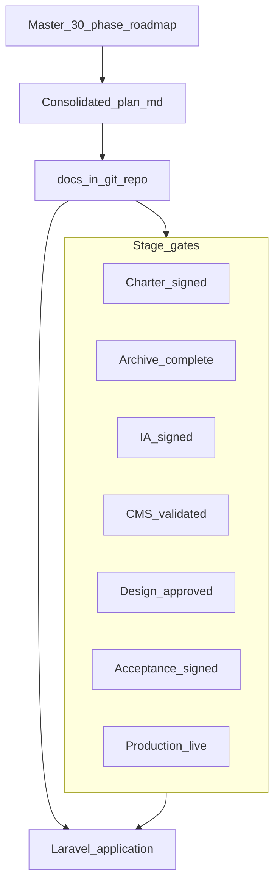

# PROOFTAG-CATIS — Plan review: what to add, update, and modify

Your attached **30-phase master roadmap** is the authoritative execution sequence. The consolidated plan in [.cursor/plans/prooftag-catis_website_redesign_85860bfc.plan.md](d:/websiteprooftag/.cursor/plans/prooftag-catis_website_redesign_85860bfc.plan.md) is a strong **executive + audit + stack** summary but **compresses Phases 4–5, 11, 20–22, and 28–30** into short tracks. To make the consolidated document more **modern, professional, and implementable**, treat it as the **top layer** and extend it as below. **Do not duplicate the full 30 phases in the consolidated file**—instead add cross-references, gates, and missing modern concerns.

---

## A. Structural changes to the consolidated plan (recommended)

### A1. Add a “document hierarchy” section (new §0)

Clarify how documents relate:

- **Master roadmap** (your 30 phases) = execution order and stage gates.
- **Consolidated plan** = audit findings, stack, IA, risks, timeline.
- **Repo `docs/`** (to create in Phase 1) = charter, URL register, content audit CSV, ERD, deploy runbook, admin manual.

This prevents the consolidated plan from trying to replace the master doc while staying the single “start here” index.

### A2. Expand §7 from five tracks to a **phase map table**

Add a table mapping **consolidated todos → master phases → gate deliverable**, so nothing is lost:

| Consolidated todo | Master phases | Gate (must pass before next) |
|-------------------|---------------|------------------------------|
| phase1-charter | 1 | Charter, scope, nav, products, contact record signed off |
| phase2-preserve | 2 | Archives + URL register + redirect draft |
| phase3-audit | 3 (+ start 4) | Audit register + verification list + product baselines |
| *(missing today)* | **4–5** | Functional spec + approved sitemap/IA |
| phase6-13-platform | 6–13 | CMS populated with representative content |
| phase14-16-ux-frontend | 14–16 | Design approval + all page templates on CMS data |
| phase17-19-migrate-seo | 17–19 | Migration QA + EN content + redirects live in config |
| *(missing today)* | **20–22** | Security checklist + perf baseline + local acceptance sign-off |
| phase22-27-lws-launch | 23–27 | Staging acceptance + production cutover |
| phase28-handover | 28–30 | Handover docs + maintenance calendar |

**Modify todos:** insert **`phase4-5-requirements-ia`** between audit and platform (or fold into phase1-charter completion criteria explicitly).

### A3. Add **explicit stage-gate template** to each track

From your master plan, every phase needs: objective, activities, deliverables, **validation**, **condition to proceed**. The consolidated plan lists deliverables implicitly but not **validation**. Add one subsection:

**Example gate (Phase 13):** “All five product records, 12 security points, 3 editorial samples, and 10 centre records exist in Filament; missing-field log is empty or waived by product owner.”

---

## B. Content from master roadmap missing in consolidated plan (add verbatim themes)

These should appear as new subsections or bullets— they materially affect quality and professionalism.

### B1. Phase 1 — Charter ( strengthen §1 + new `docs/charter/` )

Add to consolidated plan:

- **Explicit exclusions** block (CERTIDOCS/CT-VERIF/DOSER as *linked systems*, not embedded apps)—already in master; **copy summary into §1**.
- **Address line:** master includes *Hôtel de l’Air*; consolidated plan omits it—**align contact master record** with charter: *Immeuble Résidence Le Carat, Hôtel de l’Air, Bonapriso*.
- **Social channel policy:** drop legacy Yelp; standardise on LinkedIn, Facebook, X, YouTube, Instagram (from site metadata)—**verification-required** URLs in global settings.

### B2. Phase 3 — Content audit mechanics (expand §1 + §9)

Add:

- Six classification statuses: Current, Current—Rewrite, Verification Required, Historical, Archive, Reject.
- **Content audit register schema** (audit ID, source URL, migration destination, translation status)—store as `docs/content-audit.csv`.
- **2020 reform content** rule: tag all regulatory copy as current vs historical in CMS (`regulatory_documents.status`).

### B3. Phase 4 — Functional requirements (new §4.5)

Consolidated plan jumps from IA to data model. Add **public and admin capability lists** from master:

- 12+ visitor audiences (government, centres, motorists, insurers, etc.) → drives **audience blocks**, not mega-nav.
- Editorial states: Draft → Under Review → Approved → Scheduled → Published → Archived.
- Contact workflow: New → In Progress → Responded → Closed → Spam.
- Centre states: Active, Temporarily unavailable, Unverified, Archived (**imports default Unverified**).

### B4. Phase 11 — Backend domain design (new §6.1)

Add before data model:

- Domain boundaries: Corporate, Products, Expertise, TechnicalInspection, Centres, Editorial, Resources, Communication, SEO, Administration.
- Publication, translation, and media rules (no draft on public; scheduled via `schedule:run` only).
- Prevents “Fat Filament resources” anti-pattern.

### B5. Phase 12 — Admin modules checklist (expand §6 or Track B)

Consolidated plan mentions Filament but not the **full module list**. Add checklist:

- Dashboard widgets (review queue, missing translations, unverified centres, scheduled posts).
- Global settings, products (5 only), expertise (5), CT hub, 12 points, equipment, centres, team, partners, news/articles, resources, careers, media library, contacts, SEO/redirects, users/RBAC.

### B6. Phases 20–22 — Security, performance, testing (new §13)

Consolidated plan merges these into one line. Split into **actionable checklists**:

**Security (Phase 20):** no public registration; Filament MFA (plugin); rate limits on login/contact; upload MIME/size; CSRF; `APP_DEBUG=false`; docroot `public/`; dependency audit (`composer audit`).

**Performance (Phase 21):** responsive images + WebP/AVIF conversions; pagination everywhere; N+1 review; Laravel caches on deploy; **mobile performance budget** (suggest LCP &lt; 2.5s, total JS &lt; 100KB gzip on marketing pages).

**Testing (Phase 22):** functional matrix per page type; role-based admin tests; editorial lifecycle; FR/EN switch; accessibility keyboard pass; SEO canonical/hreflang; **sign-off document** before LWS deploy.

---

## C. Modern and professional upgrades (new content—not in either doc yet)

These raise the site to **2026 institutional / GovTech** standards without breaking LWS constraints.

### C1. Design and UX (extend §5)

| Addition | Rationale |
|----------|-----------|
| **Design tokens in CSS** (`@theme` Tailwind 4) | Royal blue scale, spacing, radius—no one-off hex on pages |
| **Page-level patterns** | Hero + proof strip + bento grid + FAQ accordion on product pages |
| **Long-form reading UX** | TOC, “last updated”, anchor headings on CT/regulatory pages |
| **Centre directory UX** | Region filter + search + list/map toggle (Leaflet/OSM); no fake map pins without coordinates |
| **Systematic empty states** | No “0 users / 0 regions”; no empty CMS shells on public site |
| **Branded system pages** | Custom 404, 503, maintenance; bilingual |
| **Optional trust strip** | UN Resolution 74/299, MINT partnership—factual, verified copy only |

**Typography:** specify **Plus Jakarta Sans** or **DM Sans** + **Source Serif 4** for legal body—load via `@fontsource` or self-hosted WOFF2 (performance + privacy).

**Motion:** only `transform`/`opacity`; honor `prefers-reduced-motion`.

### C2. SEO and discoverability (extend §8)

- **JSON-LD:** `Organization`, `WebSite`, `BreadcrumbList`; `SoftwareApplication` for products where appropriate (no fake ratings).
- **Open Graph defaults** + per-record OG image in CMS.
- **`/robots.txt`** and staging `noindex` via middleware/env.
- **Internal search** (optional V1.1): Laravel Scout + database driver—**defer V1** unless required; otherwise filtered listings only.

### C3. Privacy, legal, and trust (new §14)

Master Phase 16.11 mentions legal pages; consolidated plan omits them.

- **Mentions légales**, **politique de confidentialité**, **conditions d’utilisation** (FR + EN).
- **Cookie/consent banner** only if analytics or non-essential embeds are used.
- **Analytics:** prefer **privacy-first** (Plausible/Umami self-hosted or none in V1)—avoid heavy Google tags on Starter bandwidth.
- **Contact form:** honeypot + rate limit; store submissions in DB; optional notification email.

### C4. Engineering quality (new §15 — “Definition of done”)

| Practice | Tooling |
|----------|---------|
| Code style | Laravel Pint |
| Static analysis | Larastan (level 5→7 over time) |
| Tests | Pest: routes smoke, contact form, publication gates, redirect middleware |
| CI | GitHub/GitLab: `composer install`, `pint --test`, `php artisan test`, `npm run build` on PR |
| Composer platform | `"platform": { "php": "8.4.x" }` for reproducible deps on LWS |
| Branch model | `main`, `develop`, `feature/*`, `fix/*` |

### C5. Packages — refine §2 suggestions

**Adopt explicitly (one line each in plan):**

- `spatie/laravel-permission` + **Filament Shield** (maps your 8 roles to permissions).
- `spatie/laravel-activitylog` (audit trail for Phase 8.6).
- `spatie/laravel-medialibrary` + Filament plugin.
- **Pick one i18n pattern:** custom translation tables (master Phase 9.3) **or** `spatie/laravel-translatable`—document decision in ADR-001.
- Filament **TipTap** or rich editor for articles with sanitised HTML.
- `spatie/laravel-sitemap` + hreflang in sitemap generation.

**Defer V1:** Scout, Horizon, Octane, Livewire on public site (Filament only).

### C6. Operations on LWS (extend §3)

- **Deploy runbook** (`docs/deploy-lws.md`): web terminal steps, `migrate --force`, cache commands, rollback (restore backup + previous release folder).
- **Health check:** `GET /up` (Laravel 11+) monitored manually post-launch.
- **Log rotation:** `storage/logs` size on shared hosting; schedule log prune in scheduler.
- **Backup:** LWS daily backups + ** quarterly restore test** (Phase 29.3).
- **Post-launch 404 monitor:** weekly review of redirect misses (Phase 27.4).

### C7. Content and governance (extend Track E)

From master Phase 28.3, add to consolidated plan:

- **RACI:** who writes, translates, reviews, publishes, validates technical claims.
- **Glossary FR/EN** for product names (CERTIDOCS CT, CT-VERIF, DOSER, Code à Bulles).
- **Quarterly content review** calendar (centres, team, regulations).

### C8. Cameroon / audience-specific polish (optional, professional)

- **Click-to-call** and **mailto** prominent in header/footer (mobile-first).
- **French primary URLs** without `/fr` prefix; English under `/en/` (already planned)—document slug rules in ADR-002.
- **WhatsApp business link** only if CATIS provides official number—otherwise omit.

---

## D. Corrections and alignments (modify existing consolidated sections)

| Section | Change |
|---------|--------|
| §1 Contact | Add *Hôtel de l’Air* to address; note `info@net.prooftagcatis.com` deprecated |
| §4 Expertises | Explicit **five** expertise slugs aligned to site: R&D, Support technique, Data analysis & reporting, Sécurité documentaire, Sécurité et prévention routière |
| §5 UI/UX | Add **legal page** and **article** templates to Figma deliverables list |
| §6 Data model | Add **`publication_status` enum** shared by pages/articles; **`seo_meta` polymorphic** or per-translation table |
| §8 SEO | Add cross-domain redirects: `site.prooftagcatis.com` → `www.prooftagcatis.com` at DNS/hosting layer **and** in-app redirect table for path-level legacy |
| §9 Risks | Add **EN faux-localization** (legacy site issue)—mitigation: no EN publish without content review gate |
| §11 Timeline | Add **buffer week** for centre verification and legal copy approval (often critical path) |
| §12 Workspace | Point to `d:\websiteprooftag` as repo root; list expected top-level: `app/`, `docs/`, `scripts/legacy-export/` |

---

## E. Updated todo list (recommended — merge with existing 8)

Keep existing IDs; **add** and **split** for clarity:

1. **phase1-charter** — include exclusions, social policy, canonical www, contact record, `docs/charter/*.md`
2. **phase2-preserve** — REST export + www crawl + `docs/legacy-url-register.csv`
3. **phase3-audit** — `docs/content-audit.csv` + verification register + product baselines
4. **phase4-5-requirements-ia** *(new)* — functional spec + signed sitemap (master Phases 4–5)
5. **phase6-13-platform** — unchanged scope; include Phase 11 domain rules + full Filament module checklist
6. **phase14-16-ux-frontend** — add design tokens, system pages, legal templates
7. **phase17-19-migrate-seo** — unchanged + JSON-LD
8. **phase20-22-quality** *(new)* — security hardening, perf baseline, local acceptance sign-off
9. **phase22-27-lws-launch** — rename mentally to **phase23-27** to avoid duplicate “22”
10. **phase28-handover** — admin manual + governance + maintenance calendar (Phases 28–30)

---

## F. Diagram: recommended documentation flow

---

## G. What not to add (stay disciplined)

- No public SPA, no headless front, no Redis/VPS for V1.
- No live stats from operational DBs on homepage.
- No “coming soon” product pages unless leadership explicitly accepts (master risk table).
- No DITROS-CT as product; content merge only.
- No AI chatbot on corporate site V1 (bandwidth, support, accuracy risk).

---

## H. Suggested next action (when you exit plan mode)

Apply edits to [.cursor/plans/prooftag-catis_website_redesign_85860bfc.plan.md](d:/websiteprooftag/.cursor/plans/prooftag-catis_website_redesign_85860bfc.plan.md) in this order:

1. Insert §0 document hierarchy + phase map table (Section A2).
2. Add §4.5 functional requirements + §6.1 domain design + §13 quality gates (Sections B–B6).
3. Add §14 legal/privacy + §15 engineering DoD (Section C).
4. Apply corrections table (Section D).
5. Update frontmatter `todos` with `phase4-5-requirements-ia` and `phase20-22-quality` (Section E).

Your **30-phase master document** remains the detailed step-by-step; the consolidated plan becomes the **modern professional brief** that executives and developers share, with nothing important left implicit.
