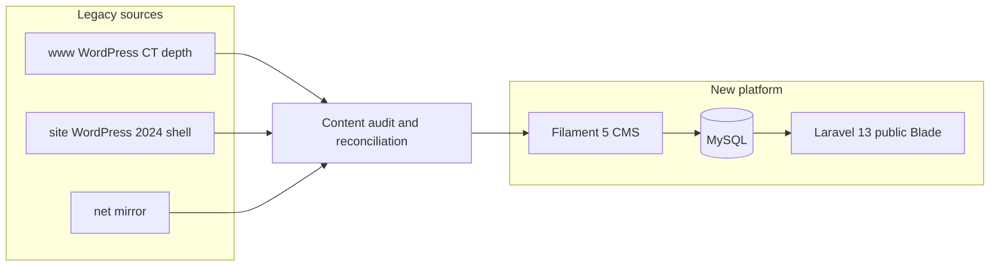

# PROOFTAG-CATIS — Consolidated redesign and implementation plan

## 0. Sequential execution model (mandatory)

**Does this plan respect step-by-step delivery?** The original consolidated summary **partially did not**: it grouped Phases 1–30 into five “tracks” and eight todos that could be read as doing **documentation, setup, database, backend, admin, design, and frontend at once** (especially `phase6-13-platform` and `phase14-16-ux-frontend`). That conflicts with your master rule: **one phase completes and passes its gate before the next begins.**

This document is now aligned with your **Complete Technical Website Implementation Plan** (30 phases). Rules:

1. **Strict order:** Documentation → Requirements → Content audit → Information architecture → Technical architecture → Local setup → Application foundation → **Database design (Phase 9)** → **Database implementation (Phase 10)** → **Backend domain design (Phase 11)** → **Admin (Phase 12)** → **CMS validation (Phase 13)** → **UI/UX design (Phase 14)** → **Frontend foundation (Phase 15)** → **Public frontend (Phase 16)** → Migration → Bilingual → SEO → Security → Performance → Testing → LWS → Launch → Handover.
2. **No parallelisation** of database design, backend rules, Filament build, UI/UX, and public frontend. Frontend design (Phase 14) starts only after the CMS content model is validated (Phase 13). Public templates (Phase 16) start only after UI/UX approval (Phase 14).
3. **Each phase** has: objective, activities/sub-steps, deliverables, validation, **gate to next phase** (detailed in your master document). Section 7 below lists all 30 phases in order with a short explanation each; use the master doc for full sub-step text.
4. **Repo `docs/`** holds phase deliverables (charter, URL register, audit CSV, ERD, requirements, acceptance checklist) so progress is auditable without skipping steps.
5. **Todos in this file** map to sequential gates—complete todo `phase09-database-design` before `phase10-database-build`, etc.

```mermaid
flowchart TD
  P1[Phase1_Documentation] --> P2[Phase2_Preservation]
  P2 --> P3[Phase3_ContentAudit]
  P3 --> P4[Phase4_Requirements]
  P4 --> P5[Phase5_InformationArchitecture]
  P5 --> P6[Phase6_TechnicalArchitecture]
  P6 --> P7[Phase7_LocalSetup]
  P7 --> P8[Phase8_AppFoundation]
  P8 --> P9[Phase9_DatabaseDesign]
  P9 --> P10[Phase10_DatabaseBuild]
  P10 --> P11[Phase11_BackendDesign]
  P11 --> P12[Phase12_Admin]
  P12 --> P13[Phase13_CMSValidation]
  P13 --> P14[Phase14_UIUX]
  P14 --> P15[Phase15_FrontendFoundation]
  P15 --> P16[Phase16_PublicFrontend]
  P16 --> P17[Phase17_Migration]
  P17 --> P18[Phase18_Bilingual]
  P18 --> P19[Phase19_SEO]
  P19 --> P20[Phase20_Security]
  P20 --> P21[Phase21_Performance]
  P21 --> P22[Phase22_Testing]
  P22 --> P23[Phase23_LWSPrep]
  P23 --> P24[Phase24_Staging]
  P24 --> P25[Phase25_ReleasePrep]
  P25 --> P26[Phase26_Production]
  P26 --> P27[Phase27_PostLaunch]
  P27 --> P28[Phase28_Handover]
  P28 --> P29[Phase29_Maintenance]
  P29 --> P30[Phase30_InfrastructureReview]
```

---

## 1. What the live sites contain today (audit summary)

Two WordPress properties plus a third mirror must be treated as **one migration source**, not two products.

| Source | Role today | Rich content | Gaps / issues |
|--------|------------|--------------|----------------|
| [www.prooftagcatis.com](https://www.prooftagcatis.com/) | Legacy **operational / CT** site | Deep IA: About (organisation, history, mission, regulations, gallery), Solutions (road safety, BI, document security, **contrôle technique**, **12 security points**), Services (**Certidocs CT**, equipment, bubble seals, secured PV, support), **~35 inspection centres** by region, **stakeholder/industry** pages, careers | Positioning still framed as *“opérateur de sécurisation des vignettes”* (2020-era); `sitemap.xml` returns 500; REST API locked (401); mixed social links (incl. Yelp); actualité section largely empty |
| [site.prooftagcatis.com](https://site.prooftagcatis.com/) | **2024 corporate** redesign (Astra/Templately) | CATIS narrative, UN Resolution 74/299, team names/titles, expertise tiles, solution stubs for **DITROS-CT**, **CT-VERIF**, **DOSER**; media library via open REST | Only **16 published pages**; **no blog posts**; **EN switch shows French**; homepage **0/0 stats** (placeholders); several pages thin/empty (e.g. sécurité documentaire body); **DITROS-CT** conflicts with your confirmed product list |
| [net.prooftagcatis.com](https://net.prooftagcatis.com/) | Mirror of old www variant | Same 12-point + contact pattern | Uses `info@net.prooftagcatis.com` — retire with redirects |

**Confirmed contact baseline** (align with your charter): Immeuble Résidence Le Carat, Bonapriso; BP 4601 Douala; +237 699 19 29 19; `info@prooftagcatis.com`.

**Product naming reconciliation (critical):**

- **Keep:** CERTIDOCS CT, CERTIDOCS CT Reporting Platform, CT-VERIF, DOSER, Video Enforcement — per your charter.
- **Do not migrate as a product:** DITROS-CT — map any factual CT workflow text from [DITROS-CT](https://site.prooftagcatis.com/solutions/ditros-ct/) into **CERTIDOCS CT** + **Contrôle technique** knowledge, then **301** old URL to the new product/knowledge destination.
- **Content gaps on legacy web:** No dedicated public pages found for **Video Enforcement** or **Reporting Platform** — plan explicit stakeholder workshops + internal docs before V1 copy (do not invent capabilities).

**Authoritative depth by topic:**

- **12 security points:** www homepage + dedicated section (verbatim list suitable for CMS records, professional rewrite for public UI).
- **CT workflow:** [Contrôle technique](https://www.prooftagcatis.com/solutions/controle-technique/) (centre server, MINT centralisation, field control smartphones, CATIS quality role).
- **Centre directory:** [Centres de contrôle](https://www.prooftagcatis.com/partenaires/centres-de-controle/) — structured list (regions, operators, phones, emails; map referenced but data is list-first).
- **Corporate/team:** [CATIS](https://site.prooftagcatis.com/catis/) — Marceline TCHANGA, Jocelyn NGAE, Kelly NJIEMELI, Serge TAMPOLLA (titles must be **verification-required** before publish).
- **Solutions one-liners:** [CT-VERIF](https://site.prooftagcatis.com/solutions/ct-verif/), [DOSER](https://site.prooftagcatis.com/solutions/doser/).

**Preservation tactic (Phase 2 enhancement):**

- **site.prooftagcatis.com:** automated export via [WP REST](https://site.prooftagcatis.com/wp-json/wp/v2/pages?per_page=100&_fields=id,slug,link,title,modified,parent,status) + media endpoint (paginate all media IDs).
- **www.prooftagcatis.com:** full crawl (HTTrack or similar) + manual capture of menu URLs because REST is restricted.
- Store: HTML, text extracts, image URLs, PDFs, and a **legacy URL register** before any DNS cutover.

---

## 2. Recommended technology stack (validated for LWS Starter)

Your baseline is **appropriate** for LWS Starter shared hosting: server-rendered Laravel, no Redis/Horizon/Octane/VPS requirement for V1.

| Layer | Choice | Why on LWS Starter |
|-------|--------|---------------------|
| Backend | **Laravel 13** | LTS-style support window; fits PHP hosting model ([Laravel on LWS](https://www.lws.fr/hebergement-laravel.php)) |
| Runtime | **PHP 8.4** | Matches LWS PHP range; avoids Symfony 8 / PHP 8.4 edge cases on newer 13.x patches — pin `composer.json` `config.platform.php` if dev machines differ |
| DB | **MySQL** | Native on mutualised Linux |
| Public UI | **Blade + Tailwind CSS 4 + Vite** | Pre-built assets only in production (no Node server) |
| Behaviour | **Vanilla JS + Alpine.js** (selective) | Centre map/filters, mobile nav, language switch — no SPA |
| Admin | **Filament 5** (+ Livewire 4) | Full CMS for non-developer updates |
| Icons | **Lucide** | Lightweight SVG |
| i18n | **FR default, EN secondary** | Prefix routes (`/`, `/en/...`) + translation tables |
| VCS | **Private Git** | Local-first → staging → production |

**Suggested Composer packages (additive, not replacements):**

- `spatie/laravel-medialibrary` — media with conversions (WebP/AVIF-friendly workflow).
- `spatie/laravel-translatable` *or* your planned custom translation tables (pick one pattern in Phase 9; do not mix).
- `spatie/laravel-sitemap` + admin-managed `robots`/meta.
- `spatie/laravel-honeypot` or equivalent — contact spam on shared hosting.
- `leaflet` (npm) + OpenStreetMap — centre directory map without paid Maps API.

**Explicitly out of scope for V1 (keep your list):** WordPress, Docker prod, Redis, queue workers, WebSockets, live operational DB feeds, AI features.

---

## 3. LWS Starter hosting strategy (concrete)

Reference quotas: [LWS Starter quotas](https://aide.lws.fr/base/Hebergement-web-mutualise/formules-hebergement-web/Quotas-formules-dhebergement-web) — **60** concurrent connections, **45 GB/month** optimal bandwidth, **768 MB** `memory_limit`, **180s** web `max_execution_time`, **200 GB** storage, **web terminal** (no SSH on Starter).

**Production layout:**

- Document root → Laravel `public/` only (non-negotiable).
- Deploy: Git pull or upload artifact via web terminal; `composer install --no-dev`; `php artisan migrate --force`; `npm ci && npm run build` **on CI or locally**, commit/build artifacts or upload `public/build`.
- Cache: `file` or `database` driver; `php artisan config:cache route:cache view:cache` on release.
- Sessions: `file` or `database`.
- Queues: **sync** in V1; scheduled publishing via **one LWS cron** calling `php8.4 /path/to/artisan schedule:run` ([cron guidance](https://aide.lws.fr/base/Hebergement-web-mutualise/Outils-web/Comment-creer-une-tache-cron-LWS-Panel)) — keep jobs under cron timeout (~4 min for PHP invocation).
- Mail: LWS SMTP + SPF/DKIM for `info@prooftagcatis.com`.
- **Cloudflare:** if used, cron via HTTP may fail — use **PHP cron path** or cron on non-Cloudflare hostname ([LWS note](https://aide.lws.fr/base/Hebergement-web-mutualise/Outils-web/Comment-creer-une-tache-cron-LWS-Panel)).

**Environments:** local → **staging subdomain** (`staging.prooftagcatis.com`, `noindex` + basic auth) → production.

**Canonical domain (suggestion):** **`https://www.prooftagcatis.com`** as primary; 301 from `site.`, `net.`, and apex if desired. Single sitemap/hreflang base. (Matches typical institutional practice; finalize in Phase 1 charter.)

---

## 4. Information architecture (your baseline + audit adjustments)

Keep your **logo-as-home** rule (no “Accueil” nav item) and top-level sections:

- À propos / About Us  
- Produits & Solutions (5 products)  
- Expertises (5 domains — merge www “Solutions” marketing themes with site expertise)  
- Contrôle technique (knowledge hub — **not** a sixth product)  
- Centres de contrôle (directory)  
- Ressources (regulations, guides, brochures — from www “Lois et règlements” + downloads)  
- Actualités & Articles  
- Contact  

**Absorb legacy sections without duplicating nav bloat:**

| Legacy (www) | New home |
|--------------|----------|
| Services → Certidocs / équipements / PV / scellés | **CERTIDOCS CT** product + **Contrôle technique** + **Ressources** |
| Industries / stakeholders | **Audience landing blocks** on product/expertise pages + optional CMS “Audiences” (no 10-item top nav) |
| Galerie | **Media-driven gallery** under About or Resources |
| Carrière | **Careers module** (Filament) — already in your Phase 12 |

**Homepage (modern UX suggestion):** Hero = CATIS transport/road-safety positioning (from site) + primary CTAs (Solutions, Contrôle technique, Contact). Secondary band = 5 products. Tertiary = expertise grid. **Omit live UTILISATEURS/RÉGIONS counters** unless you later approve verified stats (your preference: not necessary for V1).

---

## 5. UI/UX direction (professional, modern — Phase 14)

Brand: **Royal blue + white** only; extract exact hex from official logo asset ([site logo URL from Yoast metadata](https://site.prooftagcatis.com/wp-content/uploads/2024/07/cropped-Logo_Prooftag_CATIS_SA_Redesigne_Ok-removebg.png)).

**Design system targets:**

- Typography: one neutral sans (e.g. **DM Sans** or **Plus Jakarta Sans**) + optional serif for long-form regulatory content.
- Layout: generous whitespace, **bento-style** product cards, clear hierarchy (short lead + expandable detail).
- Motion: subtle section reveals; **`prefers-reduced-motion`** respected.
- Photography: reuse 2024 site hero/stock where licensed; replace with authentic CATIS/centre photography when available.
- Trust: partner logos (MINT, Prooftag SAS), team module, certification/process diagrams for 12 points.
- Accessibility: **WCAG 2.2 AA** — contrast on blue backgrounds, focus rings, form labels (fix legacy issues like all-caps 12-point list in UI — keep accessible numbered components).

Deliverables: Figma (or similar) for **homepage, product detail, CT knowledge hub, centre directory, article, contact** before Phase 16 bulk build.

---

## 6. Data model highlights (Phase 9 design, then Phase 10 build — separate gates)

Phase **9** produces the approved ERD and translation rules; Phase **10** implements migrations only after sign-off. Entity list (summary):

- **`stakeholder_audiences`** (optional): maps legacy “Industries” cards to products/expertise (many-to-many).
- **`inspection_centres`**: import www list as **Unverified** until field validation; geocode later for map pins.
- **`regulatory_documents`**: `status` = current | historical | archive (2020 reform content separated).
- **`products`**: `external_url` for CT-VERIF, DOSER, Reporting Platform login/docs.
- **`redirects`**: include `site.prooftagcatis.com/*` and `www.prooftagcatis.com/*` rules.

---

## 7. Master roadmap — 30 phases in order (summary; full sub-steps in your technical plan)

Execute **one phase at a time**. Do not start the next row until the **gate** for the current phase is satisfied.

| Phase | Focus | What happens (summary) | Gate (do not proceed until…) |
|-------|--------|-------------------------|------------------------------|
| **1** | Project documentation | Charter, scope, 5 products, exclusions, contact record, brand, nav principles | Decisions stable; **no source code** |
| **2** | Legacy preservation | URL inventory, page/media/document archives, redirect register draft, backups | Sources preserved |
| **3** | Content audit | Audit register, six statuses, duplicate reconciliation, verification list, product baselines | Categories understood |
| **4** | Functional requirements | Audiences, public/admin functions, editorial workflow, non-functional requirements | Requirements stable |
| **5** | Information architecture | Sitemap, content types, relationships, navigation spec | IA approved; **no DB finalisation before this** |
| **6** | Technical architecture | Stack, environments, LWS constraints, storage, security boundaries | Architecture agreed |
| **7** | Local setup | PHP/Composer/MySQL/Node, Git, `.env`, mail testing, dev standards | Reproducible local install |
| **8** | Application foundation | Laravel 13, locales, Filament base, roles, audit logging | Foundation stable |
| **9** | **Database design** | Conceptual model, translation model, ERD, indexing, retention policy | ERD approved; **no bulk migrations before this** |
| **10** | **Database implementation** | Migrations, reference seeds, relationship verification | Schema tested |
| **11** | **Backend domain design** | Domains, validation, publication, translation, media, centre/contact rules | Rules stable for admin UI |
| **12** | **Administration (Filament)** | Dashboard, settings, products, expertise, CT, centres, editorial, SEO, users | CMS operable |
| **13** | CMS content validation | Sample products, articles, 12 points, centres, FR/EN samples | Model proven with real data |
| **14** | **UI/UX design** | Brief, tokens, templates, components, responsive, a11y review, **approval** | **Design approved; no full public frontend before this** |
| **15** | **Frontend foundation** | Tailwind tokens, Blade layouts, Lucide, JS philosophy | Design system in code |
| **16** | **Public frontend** | Nav, homepage, all page types, CMS-driven, legal pages | All major templates work |
| **17** | Content migration | Corporate, products, expertise, CT, centres, resources, media, QA | Migration QA passed |
| **18** | Bilingual completion | UI + content EN, slugs, language switch, per-locale SEO | EN is real content |
| **19** | SEO & redirects | Meta, sitemap, hreflang, legacy map, DITROS-CT handling | Redirects ready |
| **20** | Security hardening | Admin MFA/rates, uploads, forms, production config, docroot | Security checklist done |
| **21** | Performance | Images, payload, queries, pagination, Laravel caches, baseline | Perf acceptable on mobile |
| **22** | Local testing | Functional, admin roles, editorial, i18n, a11y, security, SEO tests | **Signed acceptance; no LWS deploy before this** |
| **23** | LWS preparation | Account audit, DB, PHP 8.4, SMTP, SSL, backup | Hosting ready |
| **24** | Staging on LWS | Restricted staging, cron, mail, media, perf vs local | Staging acceptance |
| **25** | Release preparation | Freeze version, build assets, env, migrations, rollback plan | Release candidate |
| **26** | Production deploy | Cutover, optimisations, redirects, HTTPS, FR/EN, admin | Live site |
| **27** | Post-launch validation | Logs, contact, indexing, 404s, performance | Stabilisation period |
| **28** | Documentation & handover | Technical docs, admin manual, governance, recovery | Team can operate CMS |
| **29** | Maintenance | Updates, content reviews, backup tests, access review | Ongoing |
| **30** | Infrastructure review | Revisit VPS only if triggers met | Future path documented |

**Reporting note:** Older “Track A–E” labels are **reporting buckets only**, not permission to run phases in parallel.

---

## 8. SEO and redirect priorities

- Fix broken sitemaps on legacy hosts by publishing new `sitemap.xml` on launch.
- **High-priority redirects:**  
  - `/solutions/ditros-ct/` → CERTIDOCS CT or Contrôle technique hub  
  - All www deep CT URLs → new FR slugs + EN equivalents  
  - `site.prooftagcatis.com/*` → `www.prooftagcatis.com/*`  
- hreflang pairs for every indexable page.
- Remove placeholder **0 users / 0 regions** from indexable content.

---

## 9. Risks and mitigations

| Risk | Mitigation |
|------|------------|
| Outdated legal/operator claims on www | Verification register; legal/comms sign-off before publish |
| Centre data stale or duplicated operators | Unverified import; admin verification workflow |
| Thin 2024 site pages | Rewrite using www depth; do not ship empty CMS shells |
| LWS cron/Cloudflare | PHP cron to `schedule:run`; test on staging |
| Filament/Laravel patch drift | Lock versions in `composer.lock`; monthly security review |
| Missing Video Enforcement / Reporting copy | Phase 3 workshops; ship pages as “coming soon” **only if** leadership accepts — otherwise delay those URLs until approved |

---

## 10. Alternative stacks considered (and rejected for this project)

| Option | Verdict |
|--------|---------|
| WordPress + page builder | Perpetuates split sites and plugin debt |
| Headless (Next.js) on LWS Starter | No native Node on Starter; adds complexity |
| Laravel + Inertia/Vue SPA | Heavier JS, weaker default SEO, unnecessary on shared hosting |
| Static site (Hugo) | Cannot meet Filament CMS + directory + workflow requirements |

**Conclusion:** Your **Laravel 13 + Blade + Tailwind 4 + Filament 5** greenfield approach is the best fit for **modern UX + internal maintainability + LWS Starter constraints**.

---

## 11. Suggested project timeline (indicative)

Assuming 1–2 dedicated developers + part-time content/UX:

- **Weeks 1–4:** Phases 1–5 (audit, IA, requirements)  
- **Weeks 5–10:** Phases 6–13 (platform + CMS + sample content)  
- **Weeks 11–14:** Phase 14 UI/UX + Phases 15–16 frontend  
- **Weeks 15–18:** Phases 17–22 migration, bilingual, SEO, testing  
- **Weeks 19–20:** Phases 23–27 staging and production launch  

Adjust after content verification backlog is sized (centres + regulations are usually the long pole).

---

## 12. Workspace note

Local folder `d:\websiteprooftag` is currently **empty** — Phase 7 should initialise the Laravel repo here (or your chosen path) and connect the private remote before feature work.
