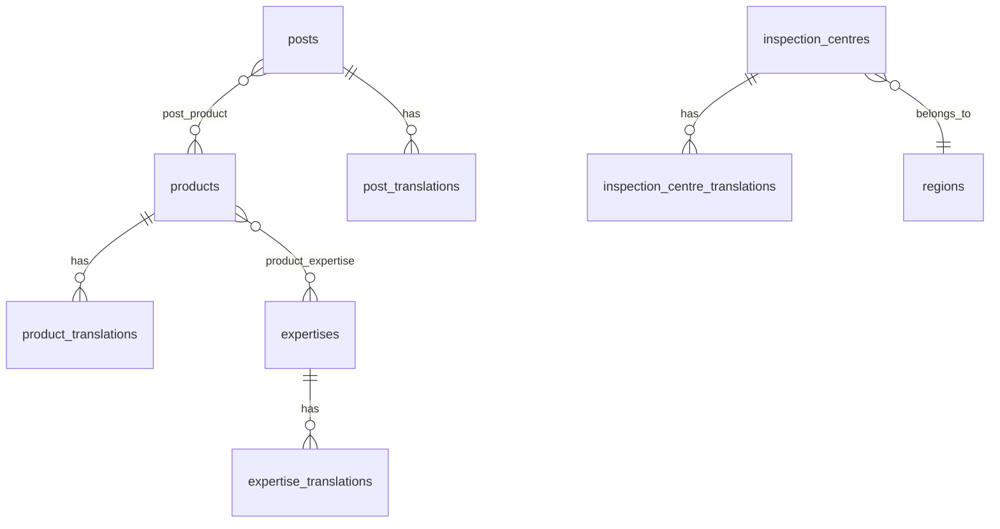

# Database logical model

Steps 039–055. No migrations until step 055 is COMPLETED. Field detail: [data-dictionary.md](data-dictionary.md).

## Core pattern

Translatable entities: base table (locale-independent) + `{entity}_translations` (locale, slug, text, SEO).

## Entities (summary)

| Table | Purpose |
|-------|---------|
| `site_settings` | Key-value or JSON settings (contact, social, default SEO) |
| `regions` | Cameroon regions for centres |
| `products` | Product code, order, status, external_url |
| `product_translations` | locale, slug, title, summary, body, meta_* |
| `expertises` / `expertise_translations` | Expertise domains |
| `security_points` / `security_point_translations` | 12 ordered points |
| `equipment` / `equipment_translations` | CT equipment |
| `inspection_centres` / `inspection_centre_translations` | Directory |
| `partners`, `team_members` + translations | Corporate |
| `resources` / `resource_translations` | Files + regulatory_status |
| `posts` / `post_translations` | News/articles |
| `categories`, `post_category` | Editorial |
| `careers` / `career_translations` | Jobs |
| `contact_requests` | Inbound form |
| `redirects` | Legacy URL map |
| `pages` / `page_translations` | Static pages if needed |
| Spatie: `media`, permissions, activity_log | Packages |

## Publication (shared concept)

On translatable content where applicable:

- `publication_status` enum on base or translation (decide in review—recommend **base** for single schedule across locales)
- `published_at`, `scheduled_for`, `reviewed_by`, `reviewed_at`

## Indexes (minimum)

- `product_translations (locale, slug)` unique  
- `post_translations (locale, slug)` unique  
- `posts (publication_status, published_at)`  
- `inspection_centres (region_id, verification_status)`  

## ERD (Mermaid)

## Gate

Approved at step 055, then migrations begin at step 056.
