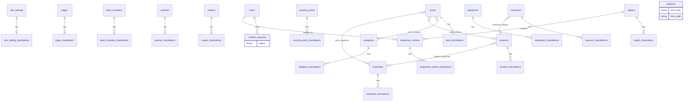

# Database logical model (ERD)

| | |
|--|--|
| **Step** | 051 — Produce the entity relationship diagram |
| **Principal entities** | [principal-entities.md](principal-entities.md) (039) |
| **Data dictionary** | [data-dictionary.md](data-dictionary.md) (052) |
| **Translation** | [translation-strategy.md](translation-strategy.md) (050) |
| **Tracker** | [STEP-BY-STEP.md](../STEP-BY-STEP.md) |
| **Version** | 1.0 |
| **Date** | 2026-10-21 |
| **Status** | ERD with cardinalities |

This is the step 051 deliverable. **No migrations before gate 055.** Identity tables already in the app (users, Spatie permission, activity_log) are shown as existing.

## Area specs

| Step | Document |
|-----:|----------|
| 039 | [principal-entities.md](principal-entities.md) |
| 040 | [corporate-entities.md](corporate-entities.md) |
| 041 | [solution-entities.md](solution-entities.md) |
| 042 | [expertise-entities.md](expertise-entities.md) |
| 043 | [technical-inspection-entities.md](technical-inspection-entities.md) |
| 044 | [centre-entities.md](centre-entities.md) |
| 045 | [editorial-entities.md](editorial-entities.md) |
| 046 | [resource-entities.md](resource-entities.md) |
| 047 | [media-entities.md](media-entities.md) |
| 048 | [contact-entities.md](contact-entities.md) |
| 049 | [seo-entities.md](seo-entities.md) |
| 050 | [translation-strategy.md](translation-strategy.md) |

## Cardinalities

| Pair | Cardinality | Required? |
|------|-------------|-----------|
| * → *_translations | 1:N | At least one locale to publish that locale |
| Product ↔ Expertise | N:N | Optional |
| Post ↔ Category | N:N | Optional |
| Post ↔ Product | N:N | Optional |
| Post ↔ Expertise | N:N | Optional |
| Resource ↔ Product | N:N | Optional |
| InspectionCentre → Region | N:1 | **Required** |
| InspectionCentre → User (`verified_by`) | N:1 | Optional until verified |
| Settings | 1 | Singleton; not related to products |
| Redirect | independent | |
| Media | attached via Spatie | Optional per owner |

Settings, Pages, Team, Partners, Careers, Products, Expertises, Points, Equipment, Posts, Resources, Centres do **not** FK to operational systems.

## Gate

Approved with the dictionary at step **055**. Migrations begin at **056**.
