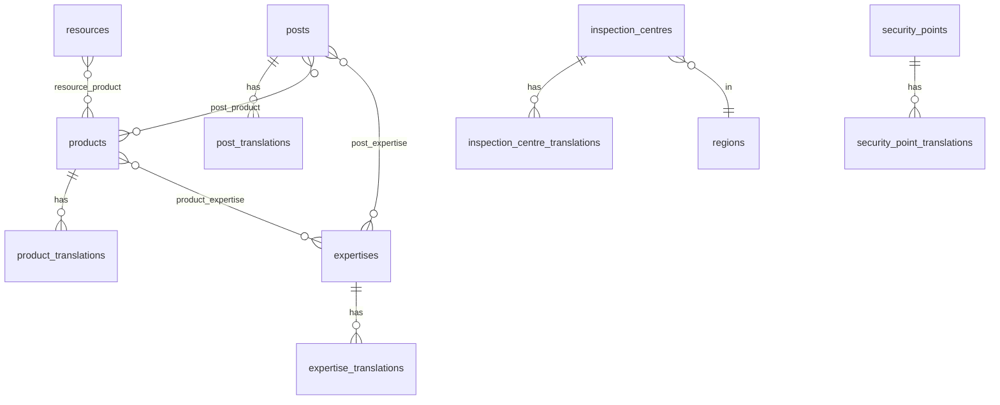

# Sitemap, content types, and relationships

| | |
|--|--|
| **Steps** | 020 final sitemap · 021 content types · 022 relationships |
| **Initial sitemap** | [initial-sitemap.md](initial-sitemap.md) v1.0 |
| **Version** | 1.0 |
| **Date** | 2026-10-20 |
| **Status** | Frozen |

Canonical host: `https://www.prooftagcatis.com`.

## 020 — Final sitemap

The initial tree in [initial-sitemap.md](initial-sitemap.md) is **confirmed**. Additions at finalisation:

| Path FR | Path EN | Type |
|---------|---------|------|
| `/recherche` | `/en/search` | Public search |
| `/a-propos/carrieres/{slug}` | `/en/about/careers/{slug}` | Career detail |
| `/ressources/{slug}` | `/en/resources/{slug}` | Resource detail |
| `/controle-technique/equipements/{slug}` | `/en/technical-inspection/equipment/{slug}` | Equipment detail |

Hidden products keep reserved paths but are omitted from nav, `sitemap.xml`, and search until published.

Admin: `https://www.prooftagcatis.com/admin` (not in the public sitemap). Staging later uses `https://staging.prooftagcatis.com` with `noindex`.

## 021 — Content types

| Type | Identity | Translation | Key fields |
|------|----------|-------------|------------|
| Settings | singleton | mixed | contact, logos, social, default SEO |
| Page | slug per locale | yes | blocks, publication |
| Product | `code` (five) | yes | sort_order, external_url, publication |
| Expertise | sort_order | yes | icon, publication |
| SecurityPoint | sort_order 1–12 | yes | body |
| Equipment | slug | yes | current / legacy |
| Region | code | yes | name |
| InspectionCentre | slug | yes | region, verification_status, contacts, geo |
| Partner | slug | yes | logo, url |
| TeamMember | slug | yes | name, title, photo, order |
| Post | slug | yes | news/article, category, schedule |
| Category | slug | yes | |
| Resource | slug | yes | file, regulatory_status, authority |
| Career | slug | yes | |
| ContactRequest | id | no | status pipeline |
| Redirect | host+path | no | to_path, status_code |
| Media | id | alt per locale | path, MIME, rights |

Publication lives on the **base** record (one schedule for the entity). A locale is publicly reachable only if its translation exists and the base is published.

## 022 — Relationships

- Product ↔ Expertise: many-to-many, optional.
- Post ↔ Product / Expertise: tagging, optional.
- Centre → Region: required.
- Resource may relate to a product or to CT knowledge, not both required.
- Redirects are independent.
- Settings are not related to products.

## Legacy absorption (no extra nav)

| Legacy | New home |
|--------|----------|
| www Industries | Audience blocks on products/expertise |
| www Galerie | Media gallery under About or Resources |
| www Lois et règlements | Resources (`regulatory_status`) |
| site DITROS-CT | CERTIDOCS CT + CT hub |
| net host | 301 to www |

## Gate

IA frozen. Architecture is steps 023–025. Principal entities: [principal-entities.md](../database/principal-entities.md) (039). Corporate attributes: [corporate-entities.md](../database/corporate-entities.md) (040). Solution attributes are step **041**.
